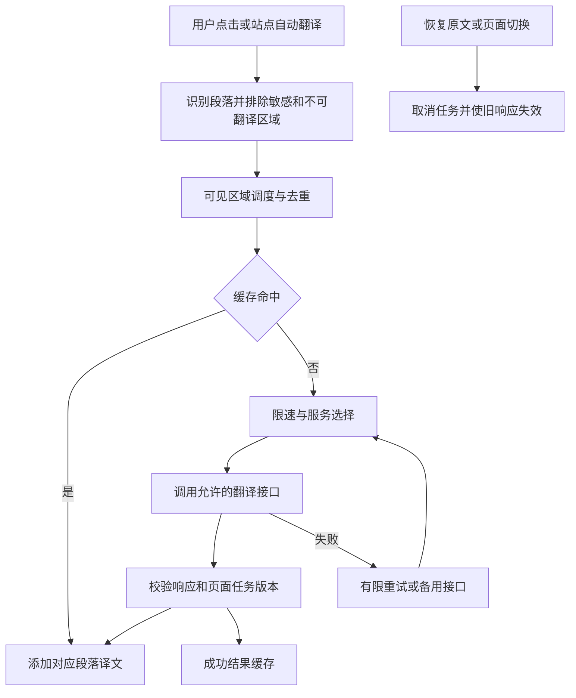

# Edge 免费网页翻译脚本开发计划

调研日期：2026-10-22，Asia/Shanghai。

> 实现状态（2026-10-22）：当前版本 v0.6.0，产物为无需构建的单文件 `edge-translator.user.js`。普通页面先收集全部正文、集中请求、统一显示；超过 160 个候选文本块或约 32000 字符时只翻译当前屏幕，滚动后继续。微软单批上限为 128 段/约 24000 字符，DeepL 为 50 段/约 24000 字符；大请求被拒绝时缩小批次。继续提供双语、仅译文、划词、两个批次并发、分片扫描、取消、接口隔离缓存和免费 Key 保护。32 项浏览器回归及 3 轮模拟基准已完成，并验证了真实微软 120 段单次请求；真实油猴/脚本猫安装验收和真实 DeepL Key 调用仍待完成。安装与限制见 `README.md`。

建议做一个安装后即可使用的双语网页翻译脚本，交付同一个 .user.js 文件，在 Windows 桌面版 Edge 的 Tampermonkey（油猴）和 ScriptCat（脚本猫）中分别运行。默认翻译成简体中文，采用“微软 Edge 网页翻译优先、DeepL 免费 Key 可选、Google 回退、MyMemory 仅手动/低质量兜底”的方案；Azure Translator F0 仍保留为后续可选接口。

核心目标是：点击方便、阅读顺畅、原网页可恢复、接口失败有退路。免费网页接口没有公开的长期开放承诺，因此接口替换、请求节制和故障处理需要在第一版完成。

本文保留为开发方案。v0.6.0 已完成核心实现，后续段落同时保留尚未落地的设计目标；具体已实现功能以 README 和 REVIEW 为准。无需滚动也可翻译普通页面的下方正文，结果在当前一轮完成后一起显示。真实油猴/脚本猫扩展安装验收和真实 DeepL Key 调用仍待完成。

你提供的仓库 qinmuran0316/- 在调研时为空仓库；本地工作目录也尚未初始化为 Git 仓库。[R1]

建议按下表执行，具体实现和验收依据见后文。

| 阶段 | 主要工作 | 可检查的产物 | 完成条件 |
| --- | --- | --- | --- |
| 0：接口与兼容性验证 | 将两个免 Key 接口接入最小测试脚本；验证跨域、自动识别、长文本、取消请求 | 临时验证脚本、两种管理器的实测记录 | 两种管理器均能发送请求并显示结果；失败类型有记录 |
| 1：最小可用版本 | 单文件安装、双语段落、恢复原文、划词、设置面板、两接口切换 | v0.1.0 安装包和安装说明 | 静态文章页可完整阅读；不破坏链接、代码和表单 |
| 2：稳定性版本 | 可见区域调度、缓存、去重、限流、熔断、SPA 和动态内容 | v0.2.0、离线回归测试、故障演练记录 | 接口断开、限流、快速切换页面时没有错贴译文或请求风暴 |
| 3：发布版本 | 站点规则、导入导出、可选 F0 接口、真实 Edge 回归、更新与回退 | v1.0.0、发布清单、变更记录 | 两种管理器分别验收通过；安装、升级、回退流程有实测记录 |
| 后续增强 | 仅译文模式、更多站点细则、可选持久缓存、开放式 Shadow DOM 支持 | v1.1+ | 依据实际使用反馈逐项增加 |

工作量先按约 7—10 个开发工作日估算，顺序为：验证 1 日，基础功能 2—3 日，稳定性 2—3 日，兼容回归与发布 2—3 日。接口变更、特殊网站适配可能增加时间；这不是接口永久可用的承诺。

参考项目选择及借鉴范围如下，源码引用固定到本次核查的提交。

| 来源 | 本次检查的位置 | 采用的思路 |
| --- | --- | --- |
| fishjar/kiss-translator | 微软、Google 适配器及项目说明；提交 b46b04213b849d3ac9874f520efc65ee12aeaeab | 双语阅读、站点规则、将不同翻译服务的协议分开处理；微软免 Key 路径 |
| FilipePS/Traduzir-paginas-web（TWP） | translationService.js、pageTranslator.js；提交 50a92116542ab93524594cc210f4bf4e5d86a925 | 在途请求合并、按服务与语种缓存、增量处理新增 DOM、页面不可见时收敛工作 |
| Tampermonkey 官方文档 | 元数据、跨域请求、存储、菜单 | 以通用 GM API 构建运行时封装 |
| ScriptCat 官方文档 | GM 请求和存储差异、返回值与取消行为 | 明确验证管理器差异，避免直接假定全部 API 行为相同 |

KISS Translator 的项目说明提供了 Edge 上使用油猴脚本的安装入口；本计划针对脚本猫的兼容性另行验收。[R2][R3][R4][R5][R6][R7]

KISS Translator 的仓库许可证为 GPL-3.0，TWP 为 MPL-2.0。[R8][R9] 建议先独立实现架构和必要协议；如采用上游代码，记录文件、提交和修改，并依据采用部分的许可证安排开源发布。项目许可证在确定实际代码复用范围后定稿，同时维护 THIRD_PARTY_NOTICES.md。

免费接口的选择以使用门槛和可维护性为依据：

| 接口 | 免费与注册情况 | 实际 v0.2 用途 | 已知边界 |
| --- | --- | --- | --- |
| Microsoft Edge 网页翻译 | 无需 Key、无需登录 | 默认主接口 | 网页前端内部端点，不能等同于官方开发者 API |
| DeepL | 免费版每月约 50 万字符；需要注册 Key | 可选高质量接口，可设为固定接口或自动回退 | 需要用户自行申请 Key；免费额度与账户资格以 DeepL 官方为准 |
| Google 网页翻译 gtx | 无需 Key | 自动回退/手动可选 | 网络可达性和接口行为需要持续验证 |
| MyMemory | 无需 Key，匿名额度约每天 5000 字符 | 仅手动选择或显式开启低质量兜底 | 质量明显低于微软/DeepL |
| Azure Translator F0 | 官方每月 200 万字符免费额度；需要资源与 Key | 尚未接入的后续选项 | 必须选择 F0 免费层；地区与资格以申请页面为准 |

微软与 Google 的免 Key 方案来自公开项目中的网页接口用法；F0 免费额度来自微软价格页。[R2][R3][R10] “本次免 Key 调用成功”和“官方长期免费开放”是不同事实，产品说明需要写清楚。

实际 v0.6.0 默认顺序为 Microsoft → DeepL（配置免费 Key 后）→ Google；MyMemory 默认不自动兜底，需用户显式开启。只向配置中允许的服务回退。用户选用固定接口后，可以关闭自动回退。Azure F0 尚未接入；脚本不创建或升级付费资源，不把需要付费的接口作为默认兜底。

第一版不引入来历不明的公共代理、共享 Key 或需要运行远程代码的接口插件。LibreTranslate 自部署可作为后续可选方案，部署与运维成本需要另计。增加第三个接口前，先验证它是否能改善当前两个接口的实际失败情况。

本次连通性测试结果如下，均使用公开、无敏感内容的英文测试句。

| 测试 | 请求与结果 | 观测耗时 |
| --- | --- | --- |
| 微软网页接口 | POST 两段英文字符串数组；HTTP 200；返回两条对应的中文翻译 | 约 698 ms |
| Google 网页接口 | GET 一段英文，client=gtx、dj=1；HTTP 200；返回中文翻译 | 约 3006 ms |

这些是当前命令行环境下的单次请求结果，不能用于推断国内外网络普遍可达、接口长期稳定或哪家始终更快。尚未验证脚本管理器中的请求、自动识别、多语种、持续负载和完整网页排版。

微软适配器的初始协议：

- 端点：`https://edge.microsoft.com/translate/translatetext`。
- POST JSON 字符串数组，以每项输入对应每项输出。
- 目标中文映射为 zh-Hans；自动识别时 from 的省略或空值行为在阶段 0 实测确认。
- 校验顶层数组、条目数量、translations 和非空文本；协议不匹配时进入失败处理，不把错误页当译文。[R2]

Google 适配器的初始协议：

- 端点：`https://translate.googleapis.com/translate_a/single`。
- GET 参数使用 client=gtx、sl=auto、tl=zh-CN、dt=t、dj=1。
- 初版一个请求对应一个段落，合并该段落响应中的 sentences[].trans。
- 不依赖把多个段落拼成一串后按换行拆回。长段落按句切分，保留片段序号后重组。
- 编码后的完整 URL 长度单独设限，避免只按原文字数判断。[R3]

安装后的默认体验应当尽量直接：

| 功能 | 默认行为 |
| --- | --- |
| 网页翻译 | 点击页面边缘的“译”按钮，普通页面整页一起显示双语内容；页面过大时只翻译当前屏幕，滚动后继续 |
| 显示方式 | 原文后添加中文译文，保留原来的链接、强调和交互 |
| 恢复原文 | 再次点击即可移除译文，并取消队列和在途任务 |
| 划词翻译 | 选中文字后出现小按钮，点击才请求；弹窗支持复制和关闭 |
| 语言 | 自动识别源语言，目标简体中文；支持手动指定源语言和目标语言 |
| 当前服务 | 面板显示正在使用的接口；发生回退时给出简短状态提示 |
| 站点记忆 | 提供“本网站自动翻译”“本网站禁用”“仅本次翻译” |
| 快捷操作 | 面板、脚本菜单及可修改快捷键均可触发；在输入框中不触发快捷键 |
| 面板 | 支持键盘操作、深色模式、按钮拖动和位置重置 |
| 故障操作 | 保留已完成译文，提供“重试失败段落”和“切换接口” |

全局自动翻译默认关闭；仅对用户主动设置的站点启用。按钮和菜单都能打开设置，避免隐藏入口。安装说明按实际发布版本说明 Edge 的扩展权限或用户脚本开关，不依靠过时的截图推断操作。

“翻译网页”以最终覆盖用户阅读到的内容为目标，并不在点击时立刻提交整页。第一次点击的面板直接说明文字将发送给所选翻译服务及允许的备用服务，设置中可以关闭自动回退，不增加逐段确认操作。

原计划采用 TypeScript 分模块开发并用 esbuild 打包。v0.2.0 为降低安装门槛，继续交付带分节注释的单文件 `edge-translator.user.js`，不引入构建依赖；面板使用原生 DOM、Shadow DOM 和局部样式。以下是模块边界，当前在单文件内按对应段落组织：

| 模块 | 职责 |
| --- | --- |
| runtime | 统一跨域请求、设置存储、脚本菜单、剪贴板和取消句柄 |
| settings | 带版本的设置模型、按站点覆盖、迁移、导入导出 |
| extractor | 识别正文段落、跳过不可翻译区域、生成稳定任务标识 |
| scheduler | 可见区域优先、分片扫描、批量提交、请求预算和取消 |
| providers | 微软、Google、可选 Azure 的请求、语种映射与响应校验 |
| cache | 正在进行的请求去重、内存 LRU、可选持久缓存 |
| renderer | 添加译文、状态展示、移除译文和节点生命周期管理 |
| site-rules | GitHub、文章、文档、论坛等场景的包含与排除规则 |
| ui | 悬浮按钮、划词弹窗、设置和错误状态 |

处理流程为：



双管理器兼容使用同一个发布文件，但在两个独立环境分别验证。跨域请求以 GM_xmlhttpRequest 的共同能力为基础，封装为返回 Promise 和 abort 的内部对象；若采用 GM.xmlHttpRequest，先检测实际能力并统一失败行为。设置写入优先使用实际返回 Promise 的 GM.setValue 等 API 并等待完成；兼容旧 API 时，不能把 await 一个 void 返回值当作落盘完成保证。[R6][R7]

脚本元数据采用 HTTP/HTTPS 匹配、document-idle、顶层页面模式；@grant 按实际用到的 API 声明；@connect 精确列出 edge.microsoft.com、translate.googleapis.com，以及接入 F0 时需要的官方域名。每个请求使用匿名模式，不添加页面 Cookie、Origin 或 Referer。跨域授权、重定向和匿名行为都要在两个管理器中检查。[R6][R7]

第一版对普通网页正文提供支持。浏览器内置页、PDF 阅读器、图片或 Canvas 内的文字、跨域 iframe、封闭 Shadow DOM 作为首发范围之外的内容，在说明中列出；实际受浏览器限制的页面通过安装说明解释。[R6]

页面处理采取以下规则，以降低排版和交互被破坏的概率：

- 优先 main、article、role=main 等正文区域；识别不到时才扫描页面候选文本块。支持用户站点规则补充。
- 跳过 script、style、pre、code、公式、输入框、textarea、contenteditable、translate=no、导航及脚本自己的节点。
- 根据段落自身内容判断是否需要翻译，不能只看整页 lang。已是目标语言、纯数字或纯标点的内容直接跳过；保留手动强制翻译入口。
- 以段落为单位聚合文字，尽量保留句子上下文；带内联链接的段落仍提取完整文本。
- 原始节点保持原位；用额外的纯文本译文节点显示结果，恢复时只移除本脚本的节点及样式。
- 表格在单元格内显示译文；列表和特殊容器按 HTML 结构选择合法插入位置，不在表格行之间插入通用 div。
- API 返回值使用 textContent 显示；识别排版不稳定的区域时，允许退化为划词翻译。
- 使用 WeakMap 管理节点状态，记录待翻译、翻译中、成功、失败、过期；移除节点后释放引用。

动态页面只对新增或变化的候选区域重新分析。MutationObserver 回调先收集变化，约 250—400 ms 合并一次，忽略自身插入的译文节点，避免触发循环。TWP 的源码可作为增量节点处理和观察器启停的参考。[R4][R5]

SPA 导航通过 popstate、hashchange，以及 DOM 变化时的 URL 检查识别；不假定在脚本沙箱中改写 history 就一定能拦截页面路由。路由、目标语言或模式改变时递增任务版本。渲染前必须再次检查版本、节点是否仍连接、原文指纹是否一致，避免旧请求贴到新页面或虚拟列表的新项目上。

实时逐字增长的内容在短暂稳定后提交；仍频繁变化时提示使用手动翻译。后台标签暂停新的低优先级扫描和请求，返回前台后从当前视口继续；恢复原文或禁用站点时停止观察器、取消可取消请求并清空未开始队列。

性能和请求参数先使用保守值，均为待压测调整的设计值，并非服务端公布的额度：

| 参数 | 初始设计值或规则 | 目的 |
| --- | --- | --- |
| 自适应范围 | 候选不超过 160 段且总文本不超过约 32000 字符时整页翻译；超出后只提交当前视口 | 普通页面一次完成，大页面控制当前屏幕请求量 |
| 预加载范围 | 大页面视口外 margin 为 0；滚动后提交新出现的内容 | 屏幕外内容不占用翻译请求 |
| 扫描分片 | 每片最多约 160 个遍历步骤或 6 ms；达到任一预算即让出执行权 | 长文章不连续占用主线程 |
| 并发 | 每标签页最多 2 个翻译批次；微软/DeepL 每接口最多 2 个在途请求，MyMemory 保持 1 个 | 提升吞吐，同时控制服务压力和响应乱序 |
| 请求间隔 | 同接口两次启动初始至少间隔约 250 ms；Google 约 400 ms、MyMemory 约 1000 ms，限流后自动扩大 | 在免费接口限制下减少短时突发 |
| 微软/DeepL 批量 | 微软 128 段/约 24000 字符，DeepL 50 段/约 24000 字符；413/414 后降至最多 32 段/8000 字符 | 尽量减少请求，同时保留服务拒绝大批次时的退路 |
| 显示时机 | 当前一轮的全部批次结束后在同一动画帧写入；接口故障时显示成功部分，失败处保留原文 | 避免逐段冒出译文，减少布局变化 |
| 请求超时 | 10 秒 | 兼容更大的批量请求 |
| Google 分片 | 每段初始不超过约 600 字符，并限制完整 URL 的编码长度；同一批最多并发 2 段 | 降低长 URL 和大请求失败概率，同时减少串行等待 |
| 请求预算 | 每个逻辑批次最多 3 轮接口尝试，包含重试与回退；拆包子请求共用轮次与取消信号，不能通过拆包重置重试 | 限制故障放大 |
| 内存缓存 | 最多约 1000 条或 2 MiB，先到限制者触发 LRU 淘汰 | 控制单页常驻内存 |
| 在途去重 | 同来源站点、接口、语种、文本及协议版本共用结果 | 避免重复段落反复请求 |

缓存键包含 origin、接口与协议版本、源语言、目标语言和文本指纹；文本标准化保持语义，不任意删除有意义的空白。切换语言或引擎不误用旧缓存，错误与空译文不作为成功结果缓存。

初版优先实现内存缓存。后续提供默认关闭的持久缓存：使用 GM 存储，按条目保存、带到期时间和容量限制，提供一键清除；不能把译文存到网站可直接读取的 localStorage。站点设置按主机分别存储，减少多个标签页覆盖同一个大型配置对象。

片段在切换接口时保留尝试次数。因请求大小而被迫拆分时，子片段继承剩余预算，并限制拆分层数和总片段数，不能通过重新入队重置失败次数。微软的多段批次回退到 Google 时，按片段分别排队，继续受相同的并发和启动间隔约束。

错误处理应当区分原因，而不是所有错误都重复发送：

| 失败类型 | 应对方式 |
| --- | --- |
| 临时网络错误、超时、5xx | 允许在预算内同接口重试一次，采用随机退避；仍失败时最多切换一次允许的备用服务 |
| 429 | 尊重 Retry-After；没有该字段时先冷却约 60 秒，不立即继续轰击同一服务 |
| 401、403 | 暂停该接口，提示权限或服务拒绝；配置型接口引导检查 Key，不无限重试 |
| 请求过大、URL 过长 | 在预算内按接口能力拆小；避免原封不动重发相同请求 |
| 响应字段或数量不符合预期 | 认定为协议故障，暂停该适配器并保留原文 |
| 所有允许服务均不可用 | 停止新的自动提交，保留已完成译文，提供手动重试入口 |

同接口在约 60 秒内连续出现 3 次可重试失败后进入冷却；429 和协议错误可以立即触发暂停。冷却结束后，只让一个实际待翻译任务尝试恢复，不另发周期性探测。取消、页面切换等用户操作不计入接口故障。

设置中的固定接口、自动回退和冷却状态要能理解：用户看到“Google 暂不可用，已改用微软”或“接口限流，稍后可重试”，而不是错误堆栈。技术诊断单独放在设置中，默认记录接口、状态码、耗时和任务编号，不记录整段原文。

多个标签页同时运行需要单独测试。可通过 GM 值变化通知共享服务冷却状态，但不能把它称为严格的跨标签全局限流。初版不引入脚本猫专有后台能力作为核心依赖，保持两种管理器的共同运行路径。[R6][R7]

隐私与数据范围落实为产品行为：

- 仅发送本次需要翻译的文本，不上传整页 HTML、页面地址、账号信息或 Cookie。
- 密码、表单和可编辑区域不进入自动翻译扫描；划词跨入这些区域时也不自动提交。
- API Key 仅保存在脚本管理器存储；导出设置默认移除 Key，界面支持清除。
- 提供站点禁用、会话内缓存和清除数据入口。
- 在面板说明正在使用的服务和备用服务；关闭自动回退后不向另一服务发送失败文本。

仓库建议采用以下结构，开发后可直接检查每项职责：

```text
src/
  main.ts
  runtime/
  settings/
  extractor/
  scheduler/
  providers/
  cache/
  renderer/
  site-rules/
  ui/
tests/
  unit/
  fixtures/
  integration/
dist/
  edge-translator.user.js
  edge-translator.meta.js
docs/
  INSTALL.md
  TEST-MATRIX.md
  PROVIDERS.md
  TROUBLESHOOTING.md
.github/workflows/
  ci.yml
README.md
CHANGELOG.md
THIRD_PARTY_NOTICES.md
LICENSE
```

测试只覆盖能够验证关键行为的内容：

| 测试层 | 重点场景 | 通过标准 |
| --- | --- | --- |
| 协议与调度测试 | 响应解析、语种映射、分片、缓存隔离、去重、429、超时、取消与预算 | 不丢段、不串语言、不超过尝试预算 |
| 本地 DOM 集成 | 内联链接、列表、表格、代码、公式、编辑框、自身 DOM 更新 | 恢复后原内容与交互仍正常；无翻译循环 |
| 动态场景 | SPA 快速切换、无限滚动、虚拟列表复用、实时文本变化 | 旧响应不写入新节点；不积累重复译文 |
| 真实 Edge + 油猴 | 安装、权限、跨域、存储、菜单、快捷键、升级 | 各操作通过并记录浏览器和扩展的实际版本 |
| 真实 Edge + 脚本猫 | 同上，另检查 GM API 行为差异 | 同一个安装包在独立配置中通过 |
| 网络故障演练 | 两服务断开、只主服务断开、限流、返回 HTML 或异常 JSON | 退路和停止行为符合设计，页面仍可读 |
| 长页面与多标签 | 约 1000 个候选块、多个标签、后台切换、反复开关 | 没有持续增长的队列或节点引用，页面交互无明显卡顿 |

真实网站首批至少覆盖：GitHub README/Issues、英文文章、技术文档、论坛帖子、Reddit 信息流。网站规则以实测可用页面为准，同时保留本地固定夹具，避免线上改版导致测试失去复现条件。

自动化测试使用模拟接口来重复验证限流、重试和错误响应，不把线上免费服务压测当日常 CI。真实接口仅做低频发布前冒烟检查，记录环境、日期、状态及样本文本。普通页面的 Playwright 测试不能代替脚本管理器内的验收。

发布前检查同一份打包产物，不仅检查源码。连续切换翻译与原文 20 次应无重复面板、遗留译文或多余监听器；切换目标语言应无缓存串用；一页内相同请求应能合并；禁止区和脚本面板自身不会被翻译。

性能结果分别报告脚本本地开销与翻译网络耗时。首屏响应随网络变化，不承诺固定几秒翻完整页；阶段 2 用固定测试页验证扫描是否遵守分片预算、视口优先是否生效，再调整初始参数。

发布采用固定安装入口，更新元信息保持 @name 和 @namespace 稳定，通过 @version、@updateURL、@downloadURL 提供升级。[R6] GitHub Releases 保存各版本安装包，README 解释 GitHub 访问失败时的手动安装方式。设置升级带 schemaVersion；升级前保留可恢复的设置副本，旧版本安装包可手动回退。

站点规则与接口地址的更改经过版本发布。首版将规则作为静态数据随脚本发布；如果以后支持规则订阅，仅接受校验过的数据，脚本不执行订阅中的 JavaScript。

v1.0 发布应交付：可直接安装的单个脚本、安装与排障说明、明确的支持范围、两种管理器的实测表、接口说明、变更记录，以及依据实际代码来源确定的许可证和第三方声明。暂不把 PDF、OCR、视频字幕、大模型翻译或跨设备同步纳入 v1.0。

调研来源如下。引用日期均为 2026-10-22，链接使用固定提交或官方页面：

[R1] 用户提供的仓库：`https://github.com/qinmuran0316/-`。

[R2] KISS Translator 微软及 Azure 适配器：`https://github.com/fishjar/kiss-translator/blob/b46b04213b849d3ac9874f520efc65ee12aeaeab/src/builtin-plugins/microsoft.js`。

[R3] KISS Translator Google 适配器：`https://github.com/fishjar/kiss-translator/blob/b46b04213b849d3ac9874f520efc65ee12aeaeab/src/builtin-plugins/google.js`。

[R4] TWP 翻译服务、缓存与在途请求：`https://github.com/FilipePS/Traduzir-paginas-web/blob/50a92116542ab93524594cc210f4bf4e5d86a925/src/background/translationService.js`。

[R5] TWP 页面处理、MutationObserver 与可见状态：`https://github.com/FilipePS/Traduzir-paginas-web/blob/50a92116542ab93524594cc210f4bf4e5d86a925/src/contentScript/pageTranslator.js`。

[R6] Tampermonkey 官方文档：`https://www.tampermonkey.net/documentation.php`。

[R7] ScriptCat 官方 API 文档：`https://docs.scriptcat.org/docs/dev/api/`。

[R8] KISS Translator 许可证：`https://github.com/fishjar/kiss-translator/blob/b46b04213b849d3ac9874f520efc65ee12aeaeab/LICENSE`。

[R9] TWP 许可证：`https://github.com/FilipePS/Traduzir-paginas-web/blob/50a92116542ab93524594cc210f4bf4e5d86a925/LICENSE`。

[R10] Azure Translator 官方价格与 F0 免费额度：`https://azure.microsoft.com/en-us/pricing/details/translator/`。

[R11] Azure Translator 官方服务限制：`https://learn.microsoft.com/en-us/azure/ai-services/translator/service-limits`。

[R12] KISS Translator 项目与油猴安装说明：`https://github.com/fishjar/kiss-translator/blob/b46b04213b849d3ac9874f520efc65ee12aeaeab/README.md`。
